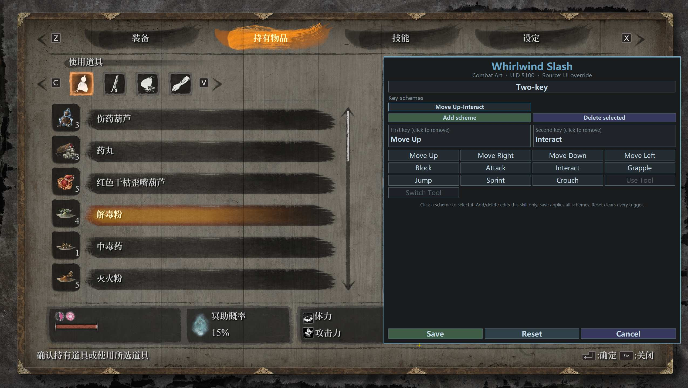
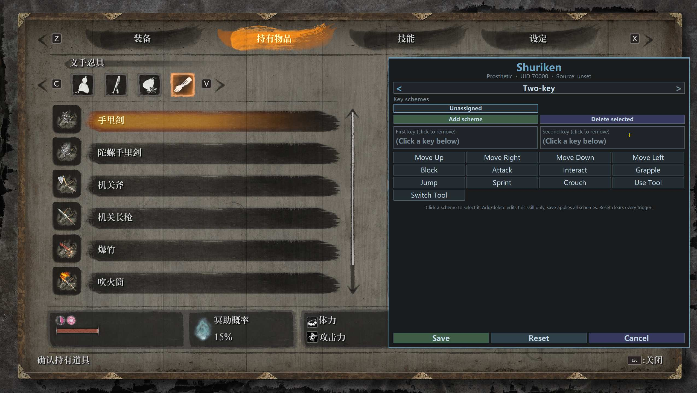
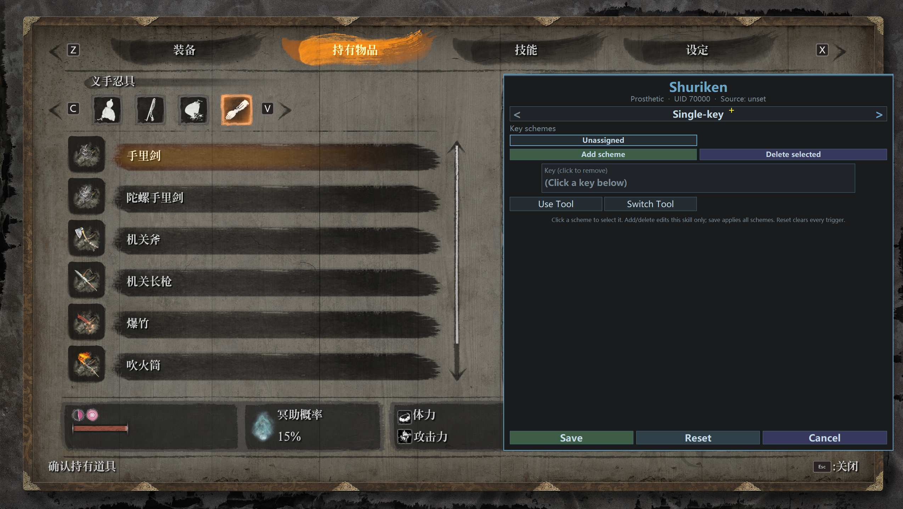
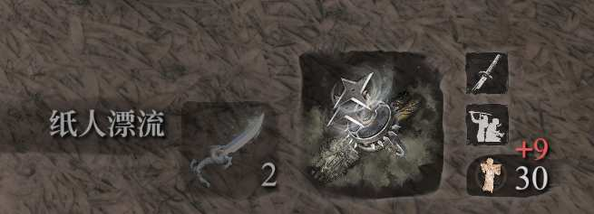

# Paper Jutsu

<h4>所谓纸人术，乃是生死间淬炼之本能，于战斗中不断磨砺的獠牙。 An instinct tempered between life and death. A fang honed in battle.</h4>

[简体中文](README.md) | **English**

A personal fork of [dec32/sekiro-battle-instinct](https://github.com/dec32/sekiro-battle-instinct), focused on paper-doll damage mitigation and more flexible keybinding configuration. The in-game UI architecture is inspired by [kargoshakar/SekiroImGuiCustom](https://github.com/kargoshakar/SekiroImGuiCustom).

## 1. MOD Overview

### 1.1 Combat-Art Keybindings

Combat arts can now be freely rebound. Go to **Skills → Combat Arts**, highlight a combat art, and press `F` to open the keybinding editor.

### 1.2 Prosthetic Keybindings

Prosthetic tools can also be freely rebound. Go to **Inventory → Prosthetic Tools**, highlight a prosthetic, and press `F` to open the editor. Both single-key and two-key triggers are supported.

### 1.3 Passive: Increased Spirit Emblem Cap

- The starting spirit-emblem cap is increased to **20**.
- Each skill that increases the emblem cap now grants **+2**, for a maximum of **30** with all relevant skills learned.
- Paper Doll Drift now grants **9** temporary emblems per use.

### 1.4 Passive: Paper Doll Damage Mitigation

Incoming hit damage is divided into tiers based on its percentage of your maximum HP. When you have enough emblems, each hit spends that tier's emblem cost to reduce the hit's HP loss by **60%**.

| Damage tier | Single-hit damage as % of max HP | Effect with enough emblems |
| --- | --- | --- |
| Tier 0 | 0% (inclusive)–10% (inclusive) | No emblem cost; no mitigation |
| Tier 1 | >10%–40% (inclusive) | Spend 1 emblem; reduce this hit's HP loss by 60% |
| Tier 2 | >40%–70% (inclusive) | Spend 2 emblems; reduce this hit's HP loss by 60% |
| Tier 3 | >70%–100% (inclusive) | Spend 3 emblems; reduce this hit's HP loss by 60% |

The boundary values 10%, 40% and 70% belong to the lower tier.

When emblems are insufficient, the following fallback rules apply:

| Current emblems | Incoming damage tier | Emblems spent | Damage reduction |
| --- | --- | --- | --- |
| 2 | Tier 3 | 2 | 30% |
| 1 | Tier 3 | 1 | 20% |
| 1 | Tier 2 | 1 | 30% |
| 0 | Any tier | 0 | None |

### 1.5 Passive: Flow

- Flow has a maximum of **10 stacks**.
- The first stack is granted after 3 perfect deflects while taking hits. After that, each additional perfect deflect within 3 seconds grants 1 stack.
- A failed perfect deflect, or more than 3 seconds without a perfect deflect, resets the stack count to zero.
- Flow reduces the posture cost of a perfect deflect.

| Flow stacks | Reduction to the deflect's posture cost |
| --- | --- |
| 1 | 20% |
| 2 | 30% |
| 3 | 40% |
| 4 | 50% |
| 5 | 60% |
| 6 | 70% |
| 7 | 80% |
| 8 | 90% |
| 9 | 100% |
| 10 | 110% |

> **About 110%:** the deflect costs no posture, and 10% of the posture cost it would otherwise consume is restored.

> **Note:** the MOD may take a while to load for the first time. Please be patient.

## 2. Download and Installation

### Download

| Edition | Download |
| --- | --- |
| Simplified Chinese | [battle-instinct_zh.zip](https://github.com/JerryZ107/sekiro-paper-jutsu/releases/download/nightly/battle-instinct_zh.zip) |
| English | [battle-instinct_en.zip](https://github.com/JerryZ107/sekiro-paper-jutsu/releases/download/nightly/battle-instinct_en.zip) |

The English release includes an English in-game key configuration UI. Set `# ui language: zh` or `# ui language: en` at the top of `battle_instinct.cfg` to switch the UI language.

See [GitHub Releases](https://github.com/JerryZ107/sekiro-paper-jutsu/releases) for all versions and updates.

### Installation

1. Download the archive and extract it into the folder containing `sekiro.exe`, keeping the directory structure intact.
2. If another MOD's `dinput8.dll` already exists in that folder, rename it to `dinput8_modengine.dll`. This MOD will load it alongside its own DLL.

## 3. Credits

- **[dec32](https://github.com/dec32)**: [Battle Instinct](https://github.com/dec32/sekiro-battle-instinct) original author — this MOD is based on their code and architecture
- **[Katalash](https://github.com/katalash)**: [ModEngine](https://github.com/katalash/ModEngine) original author — DLL and config are bundled in the release
- Param package taken from the local **Sekiro: Resurrection** installation, bundled only as the Paper Doll Drift param override
- [Tmsrise](https://github.com/tmsrise): [Sekiro Weapon Wheel](https://www.nexusmods.com/sekiro/mods/1058)
- [ReaperAnon](https://github.com/ReaperAnon): [Sekiro Hotkey System](https://www.nexusmods.com/sekiro/mods/1648)
- [Yuzheng Wu](https://github.com/Persona-woo): input-feel testing and improvements on the original
- **[kargoshakar](https://github.com/kargoshakar)**: [SekiroImGuiCustom](https://github.com/kargoshakar/SekiroImGuiCustom) — reference for the lightweight Present/ResizeBuffers hooks, WndProc + RawInput input handling, software cursor, and overlay rendering architecture
- **[rootBrz](https://github.com/rootBrz)**: [SekiroImGui](https://github.com/rootBrz/SekiroImGui) — upstream project of SekiroImGuiCustom and the original ImGui overlay implementation

See [THIRD_PARTY_NOTICES.md](THIRD_PARTY_NOTICES.md) for bundled third-party components.

## Disclaimer

Please follow the upstream repository's license and the usual Sekiro MOD conventions. This repository is a personal derivative built around a different combo philosophy. Report issues in this repository, and please do not bother the original authors.
