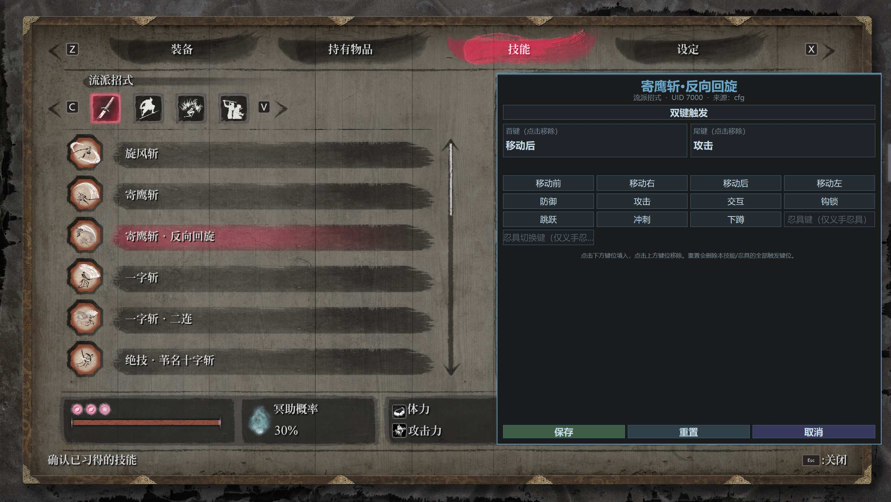
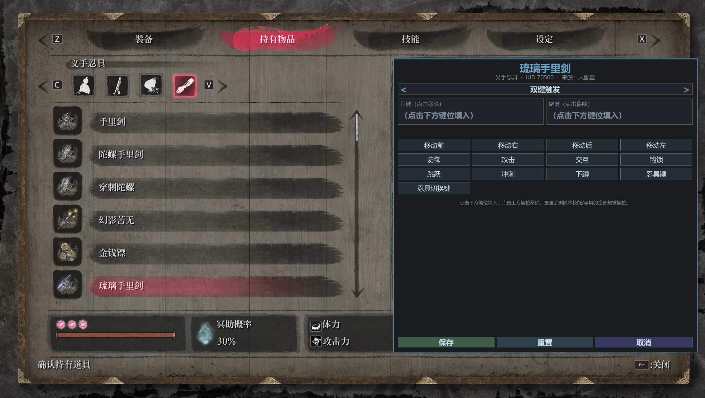
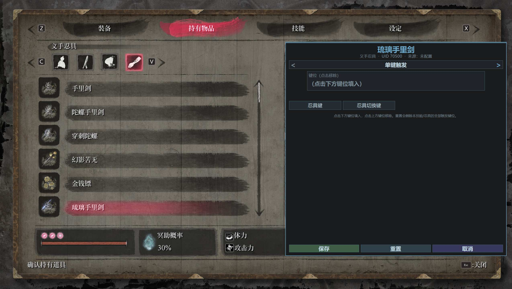
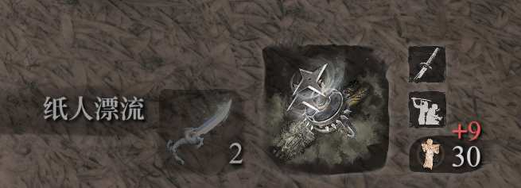

# 纸人术

<h4>所谓纸人术，乃是生死间淬炼之本能，于战斗中不断磨砺的獠牙。 An instinct tempered between life and death. A fang honed in battle.</h4>

**简体中文** | [English](README.en.md)

基于 [dec32/sekiro-battle-instinct](https://github.com/dec32/sekiro-battle-instinct) 的个人衍生版，主打双键搓招与更自由的键位配置。

## 一、MOD 介绍

### 1. 流派招式键位设置

流派招式现可自由设置键位。在「技能 → 流派招式」中选中对应技能，按 `F` 即可进入设置页面。

### 2. 义手忍具键位设置

义手忍具现可自由设置键位。在「持有物品 → 义手忍具」中选中对应忍具，按 `F` 即可进入设置页面。可配置单键触发，也可配置双键触发。

### 3. 被动：纸人上限增加

- 初始纸人上限增加为 **20**。
- 纸人上限提升技能所增加的纸人上限改为 **+2**，满技能时上限为 **30**。
- 纸人漂流使用后获得的临时纸人增加为 **9**。

### 4. 被动：纸人替伤

根据单次受伤的伤害占血量上限的比例划分伤害等级。纸人充足时，每次受击消耗 x 个纸人，减免本次掉血量的 **60%**。

| 伤害等级 | 单次受伤占血量上限 | 纸人充足时的效果 |
| --- | --- | --- |
| 第一等级 | 1%～33% | 消耗 1 个纸人，减免本次掉血量的 60% |
| 第二等级 | 33%～66% | 消耗 1 个纸人，减免本次掉血量的 60% |
| 第三等级 | 66%～100% | 消耗 1 个纸人，减免本次掉血量的 60% |

纸人不足时，按以下规则降级结算：

| 当前纸人 | 遭遇的攻击等级 | 消耗纸人 | 本次掉血量减免 |
| --- | --- | --- | --- |
| 2 | 第三等级 | 2 | 30% |
| 1 | 第三等级 | 1 | 20% |
| 1 | 第二等级 | 1 | 30% |
| 0 | 任意等级 | 0 | 无减免 |

### 5. 被动：心流

- 心流上限为 **10 层**。
- 只狼在受击时完美弹反 3 次后获得第 1 层；随后 3 秒内，每次完美弹反获得 1 层。
- 完美弹反失败，或连续超过 3 秒未完美弹反时，层数归零。
- 心流效果为完美弹反时减免本次弹反所需的躯干值。

| 心流层数 | 减免本次弹反所需躯干值 |
| --- | --- |
| 1 | 20% |
| 2 | 30% |
| 3 | 40% |
| 4 | 50% |
| 5 | 60% |
| 6 | 70% |
| 7 | 80% |
| 8 | 90% |
| 9 | 100% |
| 10 | 110% |

> **关于 110%：** 不消耗躯干值，并恢复此次弹反所需躯干值的 10%。

> **PS：** MOD 初次加载可能会花上一段时间，请耐心等待。

## 二、如何下载并使用

### 下载

| 版本 | 下载链接 |
| --- | --- |
| 简体中文版 | [battle-instinct_zh.zip](https://github.com/JerryZ107/sekiro-paper-jutsu/releases/download/nightly/battle-instinct_zh.zip) |
| English version | [battle-instinct_en.zip](https://github.com/JerryZ107/sekiro-paper-jutsu/releases/download/nightly/battle-instinct_en.zip) |

英文发行包内含英文版游戏内键位配置 UI。可在 `battle_instinct.cfg` 顶部设置 `# ui language: zh` 或 `# ui language: en` 切换界面语言。

更多版本与更新请见 [GitHub Releases](https://github.com/JerryZ107/sekiro-paper-jutsu/releases)。

### 安装

1. 下载压缩包后，请保持目录结构不变，解压到 `sekiro.exe` 所在目录。
2. 若该目录中已存在其他 MOD 的 `dinput8.dll`，请将其改名为 `dinput8_modengine.dll`；本 MOD 会将其合并加载。

## 三、感谢

- **[dec32](https://github.com/dec32)**：[Battle Instinct](https://github.com/dec32/sekiro-battle-instinct) 原作者——本 MOD 基于其代码与架构
- **[Katalash](https://github.com/katalash)**：[ModEngine](https://github.com/katalash/ModEngine) 原作者——发行包内附带其 DLL 与配置
- 参数包来自本机安装的 **Sekiro: Resurrection**，仅作为纸人漂流 param 覆盖文件随包提供
- [Tmsrise](https://github.com/tmsrise)：[Sekiro Weapon Wheel](https://www.nexusmods.com/sekiro/mods/1058)
- [ReaperAnon](https://github.com/ReaperAnon)：[Sekiro Hotkey System](https://www.nexusmods.com/sekiro/mods/1648)
- [Yuzheng Wu](https://github.com/Persona-woo)：原版输入手感测试与改进

第三方组件与打包文件说明见 [THIRD_PARTY_NOTICES.md](THIRD_PARTY_NOTICES.md)。

## 声明

请遵守上游仓库的许可与只狼 MOD 使用惯例。本仓库仅为个人搓招理念下的衍生作品，问题请在本仓库反馈，勿打扰原作者。
